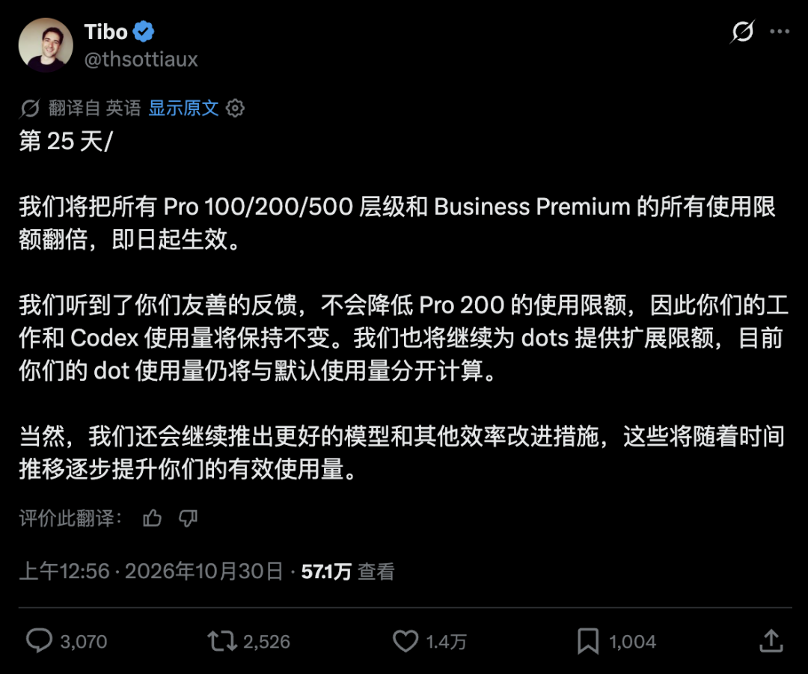
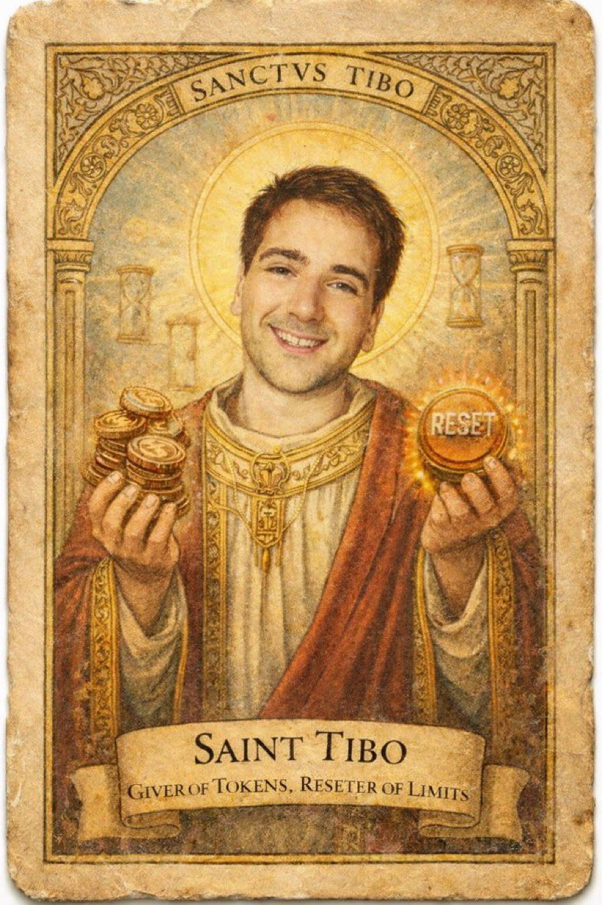
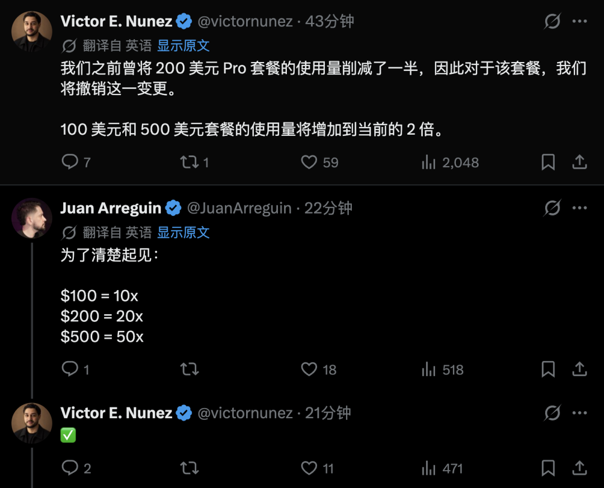
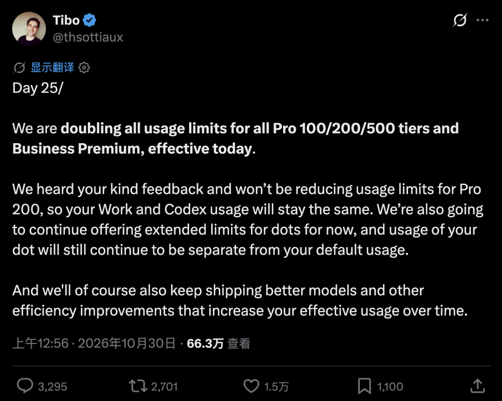

# ChatGPT Pro 全档位额度翻倍：Codex 从「重置公司」回到「Token 公司」

前一天，不少 Codex 用户还在社区里催着「最后一晚赶紧用完」，生怕 Pro 200 真的被砍额度。结果就在 2026 年 10 月 30 日凌晨，OpenAI Codex 负责人 Tibo（@thsottiaux）发帖：降额取消，**所有 Pro 档位用量上限直接翻倍，即日生效**。

从「要砍半」到「翻一倍」，中间只隔了一夜。

*社区调侃式配图：一边是 RESET，一边是 token——这次 OpenAI 选择了后者。*

## 官宣要点（按 Tibo 原帖整理）

*图：Tibo 帖子中文译文截图（原帖见文末 X 链接）。*

根据公开说明，本次调整大致包括：

1. **Pro 100 / Pro 200 / Pro 500** 以及 **Business Premium**，用量上限全部翻倍，立刻生效。
2. **原计划对 Pro 200 的降额取消**；Work 与 Codex 相关用量维持，不再按之前传闻下调。
3. ChatGPT **Personal Agent（dot）** 的扩展额度继续发放，且与默认额度**分开计算**。
4. 后续仍会推更好的模型与效率优化，相当于在「名义额度」之外继续抬「有效产出」。

Tibo 原文里写了 *We heard your kind feedback*——这个 *kind* 用得很克制。前几天社区对 Codex 额度的吐槽，语气显然不「友善」。升米恩、斗米仇，额度这件事上尤其明显。

## 从 Reset Company 到 Token Company

长期用 Codex 的人，对「重置」两个字大概不陌生：计费异常重置、活动重置、用户闹完再重置。8 月底因计费问题重置过一轮，10 月也没消停，很多人养成了习惯——额度见底先别急着换工具，说不定过两天又补回来。

于是 Tibo 自己玩起了这个梗：**Reset Company**（靠事后重置灭火）对上 **Token Company**（事前把 token 给足）。一个是补救，一个是供给；这次官方选择把叙事往后者靠。

额度对现在的重度用户，已经不只是「聊天次数」。Agent 挂着读仓库、改 bug、跑测试、提 PR——人去睡觉，它继续上班。额度≈这个数字员工本月还能上多少小时。隔壁 Claude Code 迁移成本已经很低，配额一紧，工作流就会往别处搬。模型跑分差几分未必天天感知，**额度够不够用，每天都能感知到**。

这也是为什么这次回调来得快：不是慈善，是把开发者的日常流程继续焊在 Codex 上。

## 对国内 Pro / Codex 用户意味着什么

- **已有 Pro 100/200/500 或 Business Premium**：按官方口径，上限翻倍已生效，可在产品内用量面板自行核对。
- **此前按「降额预期」调整作息或拆分账号的**：可以先回到正常节奏，再观察一两个计费周期是否稳定。
- **仍在观望开 Pro、或想对照国内通道怎么走**：可先看公开对照页，再决定自绑卡还是走人民币结算路径（不是下单硬广，只作信息备份）。

国内通道入口（对照用）：

https://chongzhi.chatgpt-plus.top/

Plus / 充值路径整理（GitHub Pages）：

https://maynor996.github.io/chatgpt-plus-recharge-guide-2026/

Pro 自动代充流程笔记：

https://maynor996.github.io/gpt-pro-auto-recharge-guide/

商品橱窗备忘（可选）：

https://wzyp.cn/shop/maynorai

## 小结

OpenAI 用一夜时间，把「砍 Pro 200」改写成「全档翻倍」，并用 Token Company 的玩笑收束社区情绪。竞争面上看，Claude Code 已经把「换一家」的门槛压得很低；额度本身变成了和模型能力并列的硬指标。

对还在用 Codex 做主力编程 Agent 的人：今晚可以少蹬一会儿额度了——至少按官宣，本轮不是砍，是加。

原帖：

https://x.com/thsottiaux/status/2115850175868727621

---

*整理说明：事实来自 OpenAI Codex 负责人公开 X 帖及社区讨论；本文为独立复述，不含原公众号品牌文案。政策以 OpenAI 产品内显示为准。*
